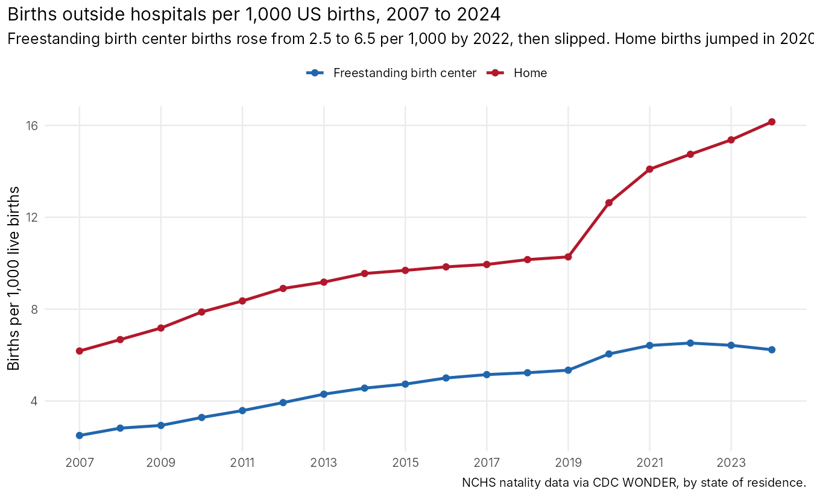

# Birth centers and certificate of need, 2007 to 2026

Where babies are born outside hospitals, state by state, and what happens when a state stops requiring a certificate of need (CON) before a birth center can open. Built from three public sources: NCHS birth certificate data (every US birth by state of residence and place of birth, 2007 to 2024, via CDC WONDER), the NPPES NPI Registry (every organization registered as a birth center, with the date it registered), and a state-by-state table of CON rules for birth centers compiled from the Pacific Legal Foundation's 2025 survey, NCSL, and the statutes themselves.

I spent eleven years trying to open a birth center in Georgia under its CON law, so I have a view. The data are set up so you can form your own.

## What the data show

- **Birth center births more than doubled, then stalled.** 10,796 US babies were born in freestanding birth centers in 2007 (2.5 per 1,000 births). By 2022 it was 23,928 (6.5 per 1,000). In 2023 and 2024 the count fell to 22,618 (6.2 per 1,000). Home births kept rising through the same years, from 6.2 per 1,000 in 2007 to 16.2 in 2024.
- **Where the state requires a certificate of need, fewer families use birth centers.** In 2022, before the recent repeals, the median state with a CON requirement for birth centers had 2.8 birth center births per 1,000; the median state without one had 7.0 (Wilcoxon p = 0.03). Ten of the sixteen CON states were below 3 per 1,000. The five states where CDC withholds the count because it is under 10 (Arkansas, Hawaii, Mississippi, North Dakota, Rhode Island) are a mix, and only Hawaii requires a CON for birth centers.
- **CON is not the whole story.** Alaska, where CON applies only above a spending threshold, has the highest rate in the country at 53.7 per 1,000. Delaware, a CON state, is fifth at 19.1. Iowa, Louisiana, Massachusetts, and Missouri have no CON requirement for birth centers and sit near the bottom anyway. Licensure rules, physician supervision mandates, hospital transfer agreements, and Medicaid payment matter too, and the CON table here does not capture them.
- **Six states dropped CON for birth centers between 2023 and 2025 (West Virginia, Connecticut, Georgia, Michigan, Kentucky, Vermont), and nothing has happened yet.** Those six were the lowest group of states for the entire eighteen years. The births data run through 2024, so only West Virginia (June 2023), Connecticut (January 2024), and half a year of Georgia (July 2024) are observable after repeal, and none of them moved. On the supply side, which runs to October 2026, the six states have registered eleven new birth center NPIs since January 2024, about four a year, against 7.6 a year from 2019 to 2023. An event study on new registrations shows no post-repeal increase: the estimates for the repeal year and the year after are zero and negative, and the second year after, which only West Virginia has reached, is positive with a wide interval.
- **Georgia.** Georgia residents' birth center births rose from 206 in 2016 to 485 in 2021, then fell every year to 367 in 2024, the year the CON exemption took effect. Home births among Georgia residents doubled over the same period, from 5.9 to 11.5 per 1,000. Georgia still requires a hospital transfer agreement before a birth center can be licensed, which the Pacific Legal Foundation describes as a competitor's veto in a different form. Two birth center NPIs have been registered in Georgia since the repeal.
- **Kentucky and Michigan show what residence-based data can and cannot tell you.** Kentucky residents had 156 birth center births in 2024 with no freestanding birth center in the state; they crossed into Tennessee, Indiana, and Ohio. Michigan's count jumped from 91 to 396 between 2021 and 2022, which looks like a change in how the state codes place of birth rather than four new birth centers opening at once.

### 2024 ranking, top and bottom

| Rank | State | CON for birth centers (2022) | Birth center births 2024 | Per 1,000 births | Active birth center NPIs |
|---|---|---|---|---|---|
| 1 | Alaska | yes | 480 | 53.7 | 21 |
| 2 | Washington | no | 1,723 | 20.7 | 79 |
| 3 | Idaho | no | 451 | 19.4 | 15 |
| 4 | Montana | no | 217 | 19.2 | 24 |
| 5 | Delaware | yes | 201 | 19.1 | 4 |
| 6 | Oregon | no | 728 | 18.7 | 38 |
| 7 | Indiana | no | 1,145 | 14.3 | 44 |
| 8 | Colorado | no | 865 | 13.5 | 133 |
| ... | | | | | |
| 42 | Maryland | yes | 78 | 1.2 | 7 |
| 43 | New York | yes | 218 | 1.1 | 53 |
| 44 | Louisiana | no | 54 | 1.0 | 28 |
| 45 | Iowa | no | 29 | 0.8 | 1 |
| 46 | Alabama | yes | 19 | 0.3 | 16 |
| 47 to 51 | Arkansas, Hawaii, Mississippi, North Dakota, Rhode Island | mixed | under 10 | | |

Full table: `output/state_table_2024.csv`. "Active birth center NPIs" counts organizations in NPPES whose primary taxonomy is Clinic/Center, Birthing; see Limits for why that is not the same as the number of birth centers.




## How it is measured

**Birth center births.** NCHS natality data, queried from CDC WONDER (Natality, 2007 to 2024) grouped by state of residence, year, and the six-level birthplace recode; "Freestanding Birth Center" is one of the six. Rates are per 1,000 live births to residents of the state. WONDER withholds counts under 10; those state-years are flagged `fbc_suppressed` and treated as zero in the cross-sectional comparison. CDC's data use terms prohibit publishing counts of 9 or fewer, and none appear here.

**Birth center supply.** The NPPES NPI Registry API, every active NPI listing taxonomy 261QB0400X (Clinic/Center, Birthing), pulled October 20, 2026. The panel keeps the 1,943 organizations (entity type 2) whose primary taxonomy is the birth center code and dates each by its enumeration date, the day it registered for an NPI. 2026 is a partial year through October 20.

**Certificate of need.** `data/con_birth_centers.csv` codes each state as requiring CON for freestanding birth centers in 2015 and in 2025, with the effective date and citation of any repeal. The current list of nine states plus DC (Alabama, Alaska, Delaware, Hawaii, Illinois, Maryland, Nevada, New York, Tennessee) comes from the Pacific Legal Foundation's October 2025 fifty-state survey. The six repeals and their dates come from the acts: West Virginia SB 613 (2023), Connecticut Public Act 23-147 (effective January 1, 2024, for Medicaid-enrolled centers, through June 2028), Georgia HB 1339 (effective July 1, 2024), Michigan Public Act 252 of 2024 (signed January 21, 2025), Kentucky HB 90 (effective June 27, 2025), and Vermont S.18 (2025). The Michigan and Vermont effective dates are the standard statutory defaults and are marked as estimates in the table. NCSL's April 2025 page lists Iowa's CON as covering birthing centers; Iowa Code 135.61 as of 2026 does not, so Iowa is coded as not covered.

**Models.** The cross-section is a Wilcoxon test on the 2022 state rates by CON status. The panel models are two-way fixed effects regressions (state and year, clustered by state) of the outcome on the share of the year a CON requirement was in force, and a Sun and Abraham event study on new NPI registrations per 100,000 births with repeal year as the cohort. They are in `output/twfe_models.csv` and `output/event_study_npi_entries.csv`. The TWFE coefficient on the births outcome is positive (1.65 per 1,000, SE 0.48), which would mean repeals reduced birth center births; it rests on three switching states, one to two post years each, and a pre-existing decline in Georgia, and should be read as "no evidence of an increase," not as an effect.

## Limits

- **State of residence, not state of occurrence.** WONDER's natality geography is where the mother lives. A Kentucky family that drives to a Tennessee birth center counts for Kentucky. That makes the residence rate a measure of what families in a state actually use, which is the policy question, but it blurs the link to in-state supply.
- **NPIs are not birth centers.** The American Association of Birth Centers counted about 400 birth centers in 2022; NPPES lists 1,943 active organizations with the birth center taxonomy as primary. Midwifery practices that attend home births, hospital-owned units, and billing entities all register under the code. The registry also drops NPIs that have been deactivated, so closures are invisible and early-year counts are survivors only. Treat the NPI series as a noisy upper bound on entry.
- **The repeals are too recent to evaluate.** Three of the six took effect after the last year of births data. Anyone citing this repository as evidence that CON repeal does nothing is reading more into it than it holds; anyone citing the 2022 cross-section as proof that CON is the cause of the gap is doing the same in the other direction.
- **Place-of-birth coding changed in some states.** Michigan's 2022 jump is the clearest case. The 2003 revised birth certificate was adopted by states between 2003 and 2016, and coding of "freestanding birth center" versus "clinic/doctor's office" is not uniform.
- **The CON table is a simplification.** Alaska's threshold and Nevada's rural-county limit are coded as CON states. Connecticut's exemption applies only to Medicaid-enrolled centers and expires in 2028. Licensure, physician, and transfer agreement rules, which the Pacific Legal Foundation survey covers and which bind at least as hard, are not in the table.

## Reproducing it

```
python3 scripts/pull_nppes.py data/raw_nppes_birth_centers.csv                                   # NPPES API, about 2 minutes
python3 scripts/pull_wonder_birthplace.py data/raw_wonder_birthplace_state_year_2007_2024.csv D66   # CDC WONDER, births by birthplace
python3 scripts/pull_wonder_birthplace.py data/raw_wonder_births_state_year_2007_2024.csv D66 totals
python3 scripts/build_panel.py data
Rscript analysis.R
```

The WONDER script does what a person does in the browser, because WONDER's XML API refuses sub-national natality queries: it accepts the data use agreement, loads the query form with its defaults, sets the group-by boxes, submits, and parses the HTML table. Running it means agreeing to [CDC WONDER's data use restrictions](https://wonder.cdc.gov/datause.html). `analysis.R` needs `tidyverse`, `scales`, `fixest`, and `ggrepel`; `usmap` adds the map.

Sources: [CDC WONDER Natality](https://wonder.cdc.gov/natality.html); [NPPES NPI Registry API](https://npiregistry.cms.hhs.gov/api-page); [Pacific Legal Foundation, State Regulation of Birth Centers: A 50-State Survey (October 2025)](https://pacificlegal.org/research/state-regulation-of-birth-centers/); [NCSL, Certificate of Need State Laws (April 2025)](https://www.ncsl.org/health/certificate-of-need-state-laws); [AABC, Birth Centers Are Growing](https://www.birthcenters.org/birth-centers-are-growing); Connecticut [OLR summary of Public Act 23-147](https://www.cga.ct.gov/2023/SUM/PDF/2023SUM00147-R02SB-00986-SUM.PDF); Georgia [HB 1339 summary](https://maynardnexsen.com/publication-georgia-health-law-update-con-reform); Kentucky [HB 90 coverage](https://lpm.org/news/2025-06-05/kentucky-midwives-say-new-state-law-will-improve-access-to-birthing-centers); Michigan [2024 HB 5636](https://www.michiganvotes.org/legislation/2024/house/bill-5636); [Iowa Code 135.61](https://www.legis.iowa.gov/docs/code/135.61.pdf).

## Files

| Path | What it is |
|---|---|
| `data/panel_state_year.csv` | 1,020 state-years (51 jurisdictions, 2007 to 2026): births, birth center and home births and rates, NPI entries and stock, CON status, event time |
| `data/panel_state_month.csv` | NPI entries by state and month, 2015 to October 2026 |
| `data/birth_centers.csv` | The 1,943 birth center organizations from NPPES: NPI, name, city, state, enumeration date |
| `data/con_birth_centers.csv` | CON status for birth centers by state, repeal dates, citations, and notes |
| `data/raw_*.csv` | The WONDER and NPPES pulls as received |
| `scripts/` | The three pull and build scripts |
| `analysis.R` | Figures, tables, and models |
| `output/state_table_2024.csv` | The ranked 2024 table |
| `output/national_trend.csv`, `output/trend_by_con_group.csv` | The series behind figures 1 and 3 |
| `output/repeal_states_panel.csv`, `output/repeal_states_npi_entries.csv` | The six repeal states |
| `output/con_comparison_2022.csv`, `output/twfe_models.csv`, `output/event_study_npi_entries.csv` | The models |
| `output/georgia.csv`, `output/georgia_monthly_npi_entries.csv` | Georgia |
| `figures/` | Seven charts, including a map |

Code is MIT licensed. The data are derived from CDC and CMS publications and are released under CC0; use of the natality figures is subject to CDC WONDER's data use restrictions.
